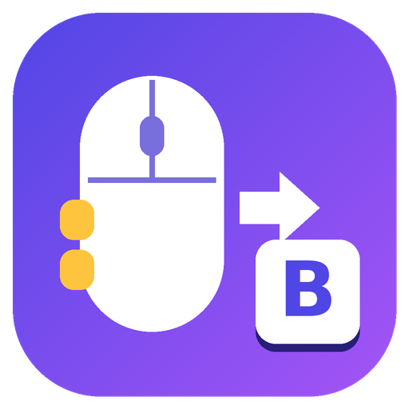

# KeyRemapper

**Turn your mouse side buttons (or any key) into any other key or mouse button.**

---

## What is it?

KeyRemapper swaps one button for another, system-wide. For example: put the letter **B** on your mouse's side button, **V** on the other one, and add as many more remaps as you want.

## Features

- **Pick by pressing.** Click *Pick*, press the button you mean, and it's recorded. No lists of key names.
- **Mouse side buttons.** Side button 1 (Back), side button 2 (Forward), and middle click all work as the "From" button.
- **Unlimited remaps.** Add as many as you want and remove any of them from the list.
- **Keys to mouse clicks.** Send a button to left click or right click.
- **On/off switch.** Untick *Remapping ON* to pause everything without closing the app.
- **Auto-saved.** Your remaps load again next time you open it.
- **Game friendly.** Keys are sent as real hardware scan codes, which most games listen for.
- **Original button blocked.** While a remap is active the old button is silenced, so your side button won't also trigger Back in the browser.
- **No install.** One small `.exe`, or one Python file.

#Made by Edu
